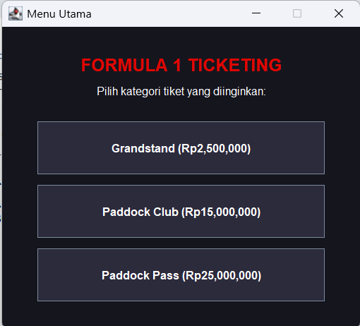
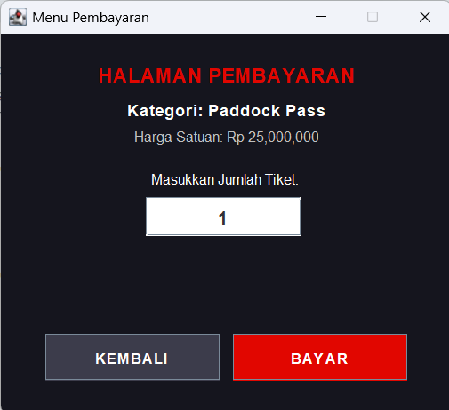
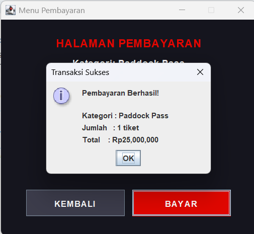

# Latihan GUI - Pemesanan Tiket F1

**NIM** : F1D02410135  
**Nama** : Salsabila Nailafahdi  
**Link Repositori GitHub** : https://github.com/naiaero/latihan-gui-f1d02410135  

Terima kasih

---

## Deskripsi Program
Program ini merupakan aplikasi GUI sederhana berbasis Java Swing untuk pemesanan tiket Formula 1 (F1). Aplikasi terdiri dari dua halaman utama:
1. **Halaman Menu**: Menampilkan pilihan kategori tiket (Grandstand, Paddock Club, Paddock Pass).
2. **Halaman Pembayaran**: Menampilkan detail tiket terpilih, form input jumlah tiket, serta tombol **Kembali** dan **Bayar** yang bersebelahan. Menampilkan dialog konfirmasi pembayaran berhasil saat transaksi diselesaikan.

---

## Komponen Utama GUI

### 1. Top-Level Container Class
* **`javax.swing.JFrame`**:
  * Diimplementasikan melalui pewarisan (*inheritance*) pada:
    * `public class HalamanMenu extends JFrame`
    * `public class HalamanPembayaran extends JFrame`

### 2. Intermediate Container Class
* **`javax.swing.JPanel`**:
  * `panelUtama`: Panel kontainer utama frame yang menggunakan `BorderLayout`.
  * `panelHeader`: Panel bagian atas untuk mengelompokkan judul dan deskripsi.
  * `panelMenu`: Panel bagian tengah untuk menampung daftar tombol pilihan tiket.
  * `panelForm`: Panel bagian tengah untuk menampung form input jumlah tiket.
  * `panelTombol`: Panel bagian bawah untuk menampung tombol navigasi **Kembali** dan **Bayar** agar posisinya bersebelahan.

### 3. Atomic Component Class
* **`javax.swing.JLabel`**: Menampilkan teks statis berupa judul program, kategori tiket, harga satuan, dan panduan input.
* **`javax.swing.JTextField`**: Bidang input teks (`txtJumlah`) bagi pengguna untuk mengisi jumlah tiket yang akan dibeli.
* **`javax.swing.JButton`**: Tombol interaktif untuk aksi pengguna:
  * Tombol kategori tiket (`tombolKategori[]`) pada menu utama.
  * Tombol **KEMBALI** (`btnKembali`) pada halaman pembayaran.
  * Tombol **BAYAR** (`btnBayar`) pada halaman pembayaran.

### 4. Layout Classes (Layout Managers)
* **`java.awt.BorderLayout`**:
  * Mengatur tata letak utama frame menjadi area `NORTH` (Header), `CENTER` (Menu/Form), dan `SOUTH` (Tombol Aksi).
* **`javax.swing.BoxLayout`**:
  * Mengatur susunan komponen secara vertikal searah sumbu Y (`BoxLayout.Y_AXIS`) pada `panelHeader` dan `panelForm`.
* **`java.awt.GridLayout`**:
  * Pada `HalamanMenu`: Mengatur tombol pilihan tiket dengan format grid 3 baris 1 kolom (`GridLayout(3, 1, 0, 12)`).
  * Pada `HalamanPembayaran`: Mengatur tombol **Kembali** dan **Bayar** agar **bersebelahan secara horizontal** dengan ukuran seragam dan simetris (`GridLayout(1, 2, 12, 0)`).

### 5. Event Listener
* **`java.awt.event.ActionListener`**:
  * Diimplementasikan langsung pada `HalamanMenu` dan `HalamanPembayaran` (`implements ActionListener`):
    ```java
    @Override
    public void actionPerformed(ActionEvent e) {
        if (e.getSource() == btnBayar) {
            prosesPembayaran();
        } else if (e.getSource() == btnKembali) {
            new HalamanMenu().setVisible(true);
            this.dispose();
        }
    }
    ```
* **`java.awt.event.KeyListener`**:
  * Diimplementasikan langsung pada `HalamanPembayaran` (`implements KeyListener`) untuk memfilter input pada `txtJumlah` agar hanya menerima karakter angka:
    ```java
    @Override
    public void keyTyped(KeyEvent e) {
        char c = e.getKeyChar();
        // Hanya mengizinkan input angka dan tombol kontrol (backspace/delete)
        if (!Character.isDigit(c) && c != KeyEvent.VK_BACK_SPACE && c != KeyEvent.VK_DELETE) {
            e.consume();
        }
    }

    @Override
    public void keyPressed(KeyEvent e) {}

    @Override
    public void keyReleased(KeyEvent e) {}
    ```

---

## Screenshot Program

### 1. Halaman Menu Utama


### 2. Halaman Pembayaran


### 3. Notifikasi Pembayaran Berhasil
